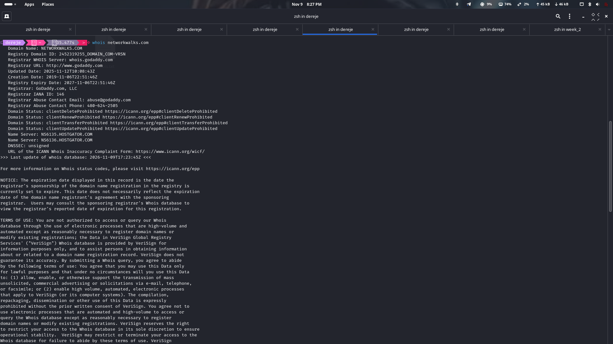
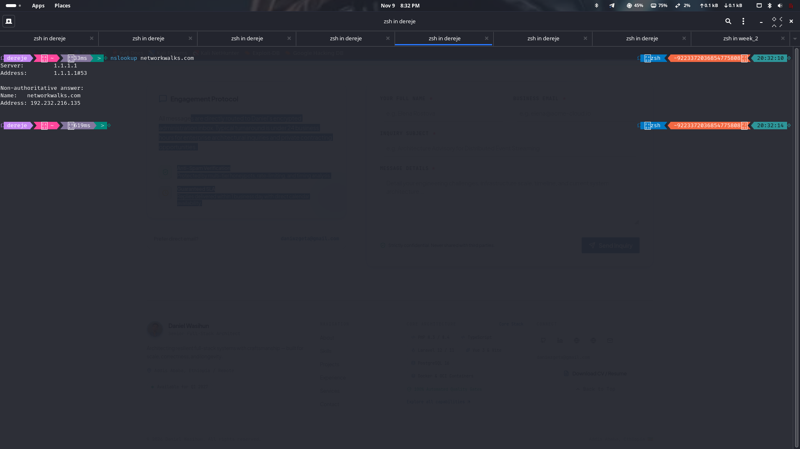
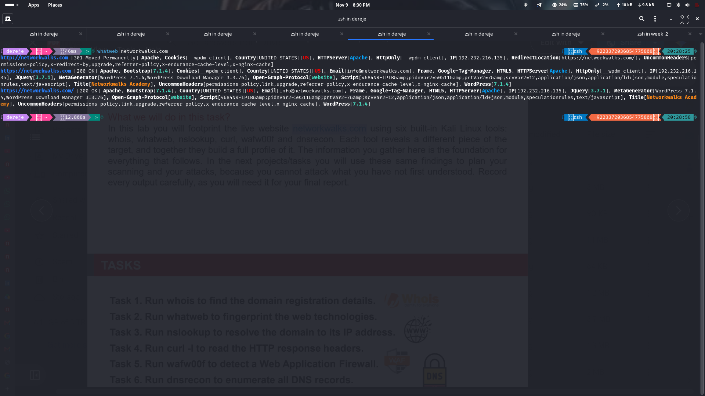
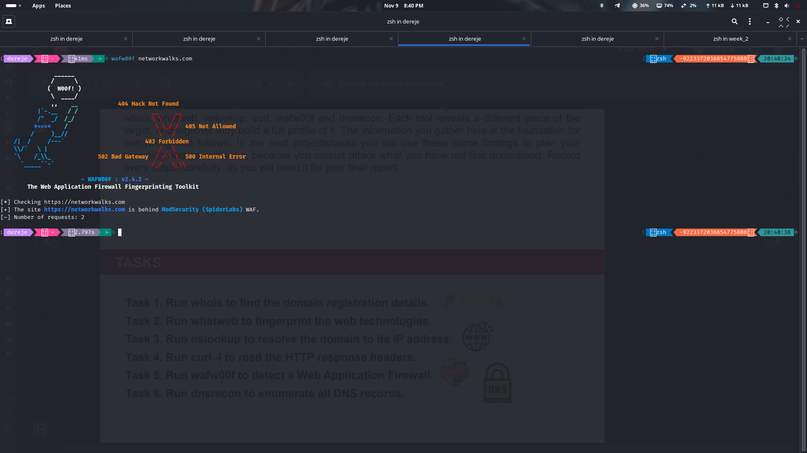
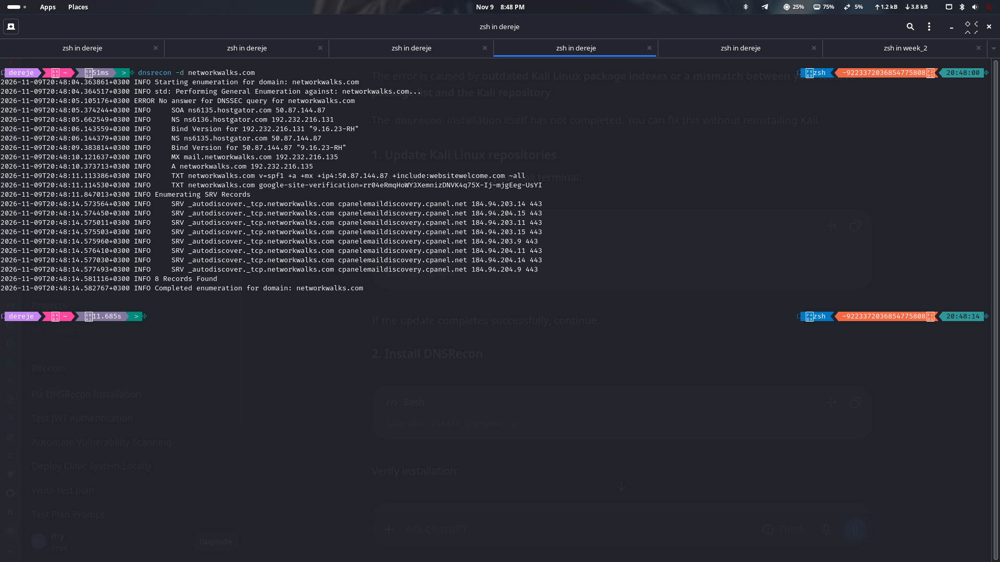
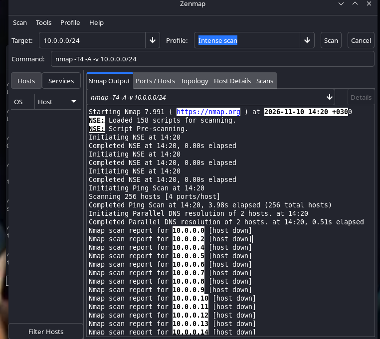

# NetworkWalks Cybersecurity Internship — Batch B084
## Week 2 Project Write-Up: Information Gathering & Reconnaissance

- **Candidate / Intern:** Dereje
- **Program & Batch:** NetworkWalks Cybersecurity Internship (Cohort B084)
- **Module:** Week 2 — Footprinting, OSINT, DNS Enumeration & Perimeter Scanning
- **Target Assets:**
  - External Target: `networkwalks.com` (`192.232.216.135`)
  - Internal Subnet Target: `10.0.0.0/24` (Hosts `10.0.0.1` and `10.0.0.3`)
- **Deliverable PDF:** [`NetworkWalks_B084_Week2_Internship_Writeup.pdf`](./NetworkWalks_B084_Week2_Internship_Writeup.pdf)
- **Date:** November 2026

---

## Table of Contents
1. [Executive Summary](#1-executive-summary)
2. [Reconnaissance Framework & Tool Taxonomy](#2-reconnaissance-framework--tool-taxonomy)
3. [Detailed Hands-On Lab Tasks & Findings](#3-detailed-hands-on-lab-tasks--findings)
   - [3.1 Task 1: Domain Registration Footprinting (`whois`)](#31-task-1-domain-registration-footprinting-whois)
   - [3.2 Task 2: DNS Resolution & Core IP Mapping (`nslookup`)](#32-task-2-dns-resolution--core-ip-mapping-nslookup)
   - [3.3 Task 3: Web Application & Stack Fingerprinting (`whatweb`)](#33-task-3-web-application--stack-fingerprinting-whatweb)
   - [3.4 Task 4: HTTP Protocol & Security Headers Analysis (`curl`)](#34-task-4-http-protocol--security-headers-analysis-curl)
   - [3.5 Task 5: Web Application Firewall Detection (`wafw00f`)](#35-task-5-web-application-firewall-detection-wafw00f)
   - [3.6 Task 6: Advanced DNS Enumeration & Zone Analysis (`dnsrecon`)](#36-task-6-advanced-dns-enumeration--zone-analysis-dnsrecon)
   - [3.7 Task 7: Subnet Discovery, Port Scanning & OS Fingerprinting (`zenmap`)](#37-task-7-subnet-discovery-port-scanning--os-fingerprinting-zenmap)
4. [Consolidated Attack Surface Profile](#4-consolidated-attack-surface-profile)
5. [Vulnerability Assessment & Risk Matrix](#5-vulnerability-assessment--risk-matrix)
6. [Actionable Security Hardening Roadmap](#6-actionable-security-hardening-roadmap)
7. [Internship Reflection & Conclusion](#7-internship-reflection--conclusion)

---

## 1. Executive Summary

Reconnaissance represents Phase 1 of both the **Penetration Testing Execution Standard (PTES)** and the **Lockheed Martin Cyber Kill Chain**. The primary objective is to systematically discover, enumerate, and map an organization's exposed assets, technology stack, perimeter defenses, and communication pathways without initiating disruptive actions.

During Week 2 of the NetworkWalks Cybersecurity Internship (Cohort B084), practical assessments were conducted across two operational environments:
1. **External Web Infrastructure (`networkwalks.com`):** Evaluated using passive OSINT and active footprinting tools (`whois`, `nslookup`, `whatweb`, `curl`, `wafw00f`, and `dnsrecon`).
2. **Internal Lab Subnet (`10.0.0.0/24`):** Scanned using Zenmap (Nmap 7.991) to evaluate host discovery, port filtering states, and remote OS fingerprints.

### Key Assessment Findings:
- **Perimeter Defense:** The web application is shielded by **ModSecurity (SpiderLabs) Web Application Firewall (WAF)**.
- **Application Architecture:** Built on **WordPress 7.1.4** and **WordPress Download Manager 3.3.76**, hosted on an Apache backend behind an Nginx reverse caching proxy.
- **DNS Exposure:** Authoritative name servers (`ns6135.hostgator.com` and `ns6136.hostgator.com`) disclosed their exact daemon version: **`BIND 9.16.23-RH`**. DNSSEC is unsigned.
- **Security Headers Deficiencies:** Missing critical HTTP defenses including HTTP Strict Transport Security (HSTS), Content Security Policy (CSP), and X-Frame-Options.
- **Internal Network Hardening:** Active nodes `10.0.0.1` (OpenBSD 6.9 Packet Filter gateway) and `10.0.0.3` enforce drop/filter firewall rules.

| Target Asset | Network Location | Primary Technology | Defense Profile | Posture Rating |
| :--- | :--- | :--- | :--- | :--- |
| **networkwalks.com** | 192.232.216.135 | WordPress 7.1.4, Apache, Nginx Cache | ModSecurity WAF, HTTPS 301 Redirect | **Moderate** |
| **mail.networkwalks.com** | 192.232.216.135 | cPanel Mail Services, Autodiscover SRV | SPF Record (SoftFail `~all`) | **Moderate** |
| **ns6135 / ns6136.hostgator.com** | 50.87.144.87 / 192.232.216.131 | BIND 9.16.23-RH | DNSSEC Unsigned, Version Disclosed | **Needs Review** |
| **10.0.0.1** | 10.0.0.1 (Gateway) | OpenBSD 6.9 (Packet Filter) | 632 Closed, 368 Filtered Ports | **Strong** |
| **10.0.0.3** | 10.0.0.3 (Lab Node) | Network Host / Appliance | 1000 Filtered Ports (Silent Drop) | **Strong** |

---

## 2. Reconnaissance Framework & Tool Taxonomy

| Reconnaissance Category | Operational Methodology | Primary Objective | Tools Employed |
| :--- | :--- | :--- | :--- |
| **Passive Reconnaissance (OSINT)** | Interrogates third-party public repositories and recursive DNS resolvers without transmitting direct packets to the target. | Identify ownership, registration timeline, IP blocks, and contact privacy. | `whois`, `nslookup` (via Cloudflare resolver) |
| **Active Web & DNS Footprinting** | Directly sends HTTP/HTTPS requests and targeted DNS queries to target servers. | Fingerprint web servers, CMS versions, WAF engines, and DNS server software. | `whatweb`, `curl`, `wafw00f`, `dnsrecon` |
| **Active Network Layer Scanning** | Transmits TCP SYN probes and ICMP packets across IP blocks. | Discover live systems, evaluate port states, and profile TCP/IP stacks. | `zenmap / nmap` |

---

## 3. Detailed Hands-On Lab Tasks & Findings

### 3.1 Task 1: Domain Registration Footprinting (`whois`)
- **Category:** Passive Reconnaissance (OSINT)
- **Command:** `whois networkwalks.com`
- **Output Log:** [`whois.txt`](./whois.txt)
- **Screenshot Evidence:**
  

#### Extracted Data:
- **Domain Name:** `NETWORKWALKS.COM` (Registry ID: `2452319255_DOMAIN_COM-VRSN`)
- **Registrar:** GoDaddy.com, LLC (IANA ID: 146)
- **Creation Date:** 2019-11-06T22:51:46Z
- **Expiration Date:** 2027-11-06T22:51:46Z
- **Registrant Organization:** Registration Private &ndash; Domains By Proxy, LLC (Tempe, AZ, USA)
- **Name Servers:** `NS6135.HOSTGATOR.COM`, `NS6136.HOSTGATOR.COM`
- **Status Locks:** `clientDeleteProhibited`, `clientRenewProhibited`, `clientTransferProhibited`, `clientUpdateProhibited`
- **DNSSEC:** `unsigned`

---

### 3.2 Task 2: DNS Resolution & Core IP Mapping (`nslookup`)
- **Category:** Passive / Semi-Passive Reconnaissance
- **Command:** `nslookup networkwalks.com`
- **Output Log:** [`nslookup.txt`](./nslookup.txt)
- **Screenshot Evidence:**
  

#### Key Findings:
- **Resolver:** `1.1.1.1:53` (Cloudflare Public Anycast DNS)
- **Resolved IPv4 Address:** `192.232.216.135`
- **Hosting Provider / ASN:** HostGator / Unified Layer datacenter in Houston, Texas, USA.

---

### 3.3 Task 3: Web Application & Stack Fingerprinting (`whatweb`)
- **Category:** Active Footprinting
- **Command:** `whatweb networkwalks.com`
- **Output Log:** [`whatweb.txt`](./whatweb.txt)
- **Screenshot Evidence:**
  

#### Fingerprint Profile:
- **CMS:** WordPress 7.1.4
- **Active Plugin:** WordPress Download Manager 3.3.76
- **Web Server Daemon:** Apache HTTP Server
- **Caching & Reverse Proxy:** Nginx Reverse Cache (`X-nginx-cache: WordPress`, `X-Endurance-Cache-Level: 0`)
- **Frontend Frameworks:** Bootstrap 7.1.4, jQuery 3.7.1, HTML5
- **Exposed Contact Email:** `info@networkwalks.com`

---

### 3.4 Task 4: HTTP Protocol & Security Headers Analysis (`curl`)
- **Category:** Active Probing
- **Command:** `curl -I networkwalks.com`
- **Output Log:** [`curl.txt`](./curl.txt)

#### Security Headers Audit:
- **HSTS (`Strict-Transport-Security`):** ❌ Missing &mdash; Users vulnerable to SSL-stripping MITM attacks.
- **CSP (`Content-Security-Policy`):** ❌ Missing &mdash; Application susceptible to XSS script injection.
- **Clickjacking Protection (`X-Frame-Options`):** ❌ Missing &mdash; Vulnerable to malicious iframe embedding.
- **MIME Sniffing (`X-Content-Type-Options`):** ❌ Missing &mdash; Lacks `nosniff` protection.
- **Information Disclosure:** `X-Redirect-By: WordPress - Really Simple Security` discloses the installed plugin.
- **Session Cookie:** `Set-Cookie: __wpdm_client=...; HttpOnly` (HttpOnly enabled, but missing `Secure` and `SameSite`).

---

### 3.5 Task 5: Web Application Firewall Detection (`wafw00f`)
- **Category:** Active Perimeter Fingerprinting
- **Command:** `wafw00f networkwalks.com`
- **Output Log:** [`wafw00f.txt`](./wafw00f.txt)
- **Screenshot Evidence:**
  

#### Findings:
- **Identified WAF:** **ModSecurity (SpiderLabs)**
- **Role:** Real-time request inspection and signature-based threat blocking against SQL injection, XSS, and remote file inclusion.

---

### 3.6 Task 6: Advanced DNS Enumeration & Zone Analysis (`dnsrecon`)
- **Category:** Active DNS Reconnaissance
- **Command:** `dnsrecon -d networkwalks.com`
- **Output Log:** [`dnsrecon.txt`](./dnsrecon.txt)
- **Screenshot Evidence:**
  

#### Discovered Records:
- **BIND Version Disclosure:** `"9.16.23-RH"` (Exposes Red Hat BIND 9.16.23).
- **SOA & NS Records:** `ns6135.hostgator.com` (50.87.144.87) & `ns6136.hostgator.com` (192.232.216.131).
- **MX Record:** `mail.networkwalks.com` &rarr; `192.232.216.135` (Co-hosted with web application).
- **SPF Record:** `v=spf1 +a +mx +ip4:50.87.144.87 +include:websitewelcome.com ~all` (Configured with SoftFail).
- **SRV Records:** 8 autodiscover records pointing to `cpanelemaildiscovery.cpanel.net:443`.
- **DNSSEC Status:** Unsigned.

---

### 3.7 Task 7: Subnet Discovery, Port Scanning & OS Fingerprinting (`zenmap`)
- **Category:** Active Network Layer Scanning
- **Target Subnet:** `10.0.0.0/24` (256 IP addresses)
- **Command:** `nmap -sS -T4 -A -v 10.0.0.0/24` (via Zenmap GUI)
- **Output Log:** [`zenmap.txt`](./zenmap.txt)
- **Screenshot Evidence:**
  

#### Results:
- **Host `10.0.0.1`:**
  - Status: Up (Latency: 0.0010s, 2 hops away)
  - Port States: 632 Closed (TCP RST), 368 Filtered (No Response)
  - Operating System: **OpenBSD 6.9** (CPE: `cpe:/o:openbsd:openbsd:6.9`)
  - Role: Security Gateway utilizing native Packet Filter (PF).
- **Host `10.0.0.3`:**
  - Status: Up (Latency: 0.00096s, 2 hops away via `10.175.10.1`)
  - Port States: 1000/1000 Filtered (Silent Drop policy).

---

## 4. Consolidated Attack Surface Profile

| Target Perimeter | Asset & Parameter | Discovered Specification | Security Status |
| :--- | :--- | :--- | :--- |
| **External Web** | Public IP | 192.232.216.135 (Houston, TX, USA) | HostGator / Unified Layer ASN |
| | Web Server | Apache HTTP Server | Banner exposed |
| | CMS & Plugins | WordPress 7.1.4 + WP Download Manager 3.3.76 | Meta generator exposed |
| | Perimeter Defense | ModSecurity (SpiderLabs) WAF | Active inspection |
| | Caching Tier | Nginx Reverse Cache + Endurance Cache | Disclosed in response headers |
| **DNS Tier** | Name Servers | ns6135 / ns6136.hostgator.com | Redundant authoritative hosts |
| | Daemon Version | BIND 9.16.23-RH | Disclosed via CHAOS query |
| | DNSSEC | Unsigned | Susceptible to DNS spoofing |
| **Mail Tier** | MX Server | mail.networkwalks.com (192.232.216.135) | Co-hosted with web server |
| | SPF Record | v=spf1 +a +mx +ip4:50.87.144.87 ~all | SoftFail policy |
| **Internal Subnet** | Host 10.0.0.1 | OpenBSD 6.9 Gateway | 632 Closed, 368 Filtered Ports |
| | Host 10.0.0.3 | Internal Appliance | 1000 Filtered Ports (Silent Drop) |

---

## 5. Vulnerability Assessment & Risk Matrix

| Finding ID | Vulnerability Description | CWE / Ref | Severity | Attack Vector |
| :--- | :--- | :--- | :--- | :--- |
| **SEC-01** | BIND Version Banner Disclosure (`9.16.23-RH`) | CWE-200 | **Medium** | Queries to the CHAOS class disclose exact software versions, enabling targeted exploit lookups. |
| **SEC-02** | Missing HTTP Security Headers (HSTS, CSP, XFO) | CWE-319 / CWE-1021 | **Medium** | Enables SSL stripping, clickjacking, and cross-site scripting vulnerabilities. |
| **SEC-03** | Absence of DNSSEC Zone Signing | CWE-345 | **Medium** | Unsigned DNS responses allow cache poisoning and DNS spoofing on intermediate resolvers. |
| **SEC-04** | CMS & Plugin Version Information Exposure | CWE-200 | **Low** | Meta generator tags disclose exact software releases to automated vulnerability scanners. |
| **SEC-05** | Permissive SPF SoftFail Configuration (`~all`) | CWE-290 | **Low** | Allows spoofed emails from unauthorized IPs to reach user spam folders instead of hard rejection. |

---

## 6. Actionable Security Hardening Roadmap

1. **Suppress BIND Daemon Version Information:**
   ```named.conf
   options {
       version none;
   };
   ```
2. **Inject Defensive HTTP Response Headers:**
   ```apache
   Header always set Strict-Transport-Security "max-age=31536000; includeSubDomains; preload"
   Header always set X-Frame-Options "SAMEORIGIN"
   Header always set X-Content-Type-Options "nosniff"
   Header always set Referrer-Policy "strict-origin-when-cross-origin"
   Header always set Content-Security-Policy "default-src 'self'; script-src 'self' 'unsafe-inline' https://www.google-analytics.com;"
   ```
3. **Implement DNSSEC Zone Signing:** Sign the authoritative zone with Key Signing Keys (KSK) and Zone Signing Keys (ZSK), publishing the DS record to GoDaddy.
4. **Harden SPF and Deploy DMARC Enforcement:**
   ```dns
   v=spf1 +a +mx +ip4:50.87.144.87 +include:websitewelcome.com -all
   v=DMARC1; p=reject; sp=reject; pct=100; rua=mailto:dmarc@networkwalks.com;
   ```
5. **Suppress WordPress Generator Tags:**
   ```php
   remove_action('wp_head', 'wp_generator');
   ```

---

## 7. Internship Reflection & Conclusion

Completing the Week 2 project provided essential hands-on experience across both offensive and defensive reconnaissance methodologies. By correlating evidence from multiple tools, I developed a deeper understanding of how modern organizations configure their public web perimeter, authoritative DNS, and private network segmentation.

- **OSINT Mastery:** Learned to extract domain governance, ownership structures, and infrastructure dependencies without generating direct alerts.
- **DNS Analysis:** Developed skills inspecting SOA, NS, MX, TXT (SPF), and SRV records to map organizational communication backbones.
- **Perimeter & WAF Fingerprinting:** Successfully detected ModSecurity (SpiderLabs) WAF filtering and identified missing HTTP security headers.
- **Network Probing:** Applied Zenmap/Nmap to survey the `10.0.0.0/24` subnet, analyzing TCP SYN responses and identifying OpenBSD 6.9 Packet Filter configurations.

---
**Candidate Signature:** Dereje  
**Program:** NetworkWalks Cybersecurity Internship (Cohort B084)  
**Date:** November 2026
